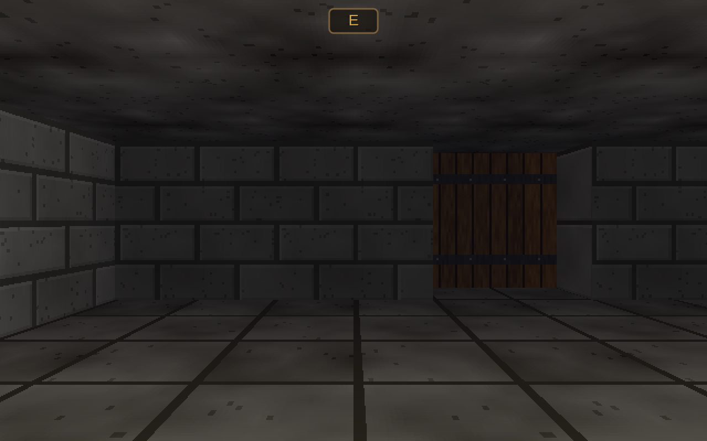
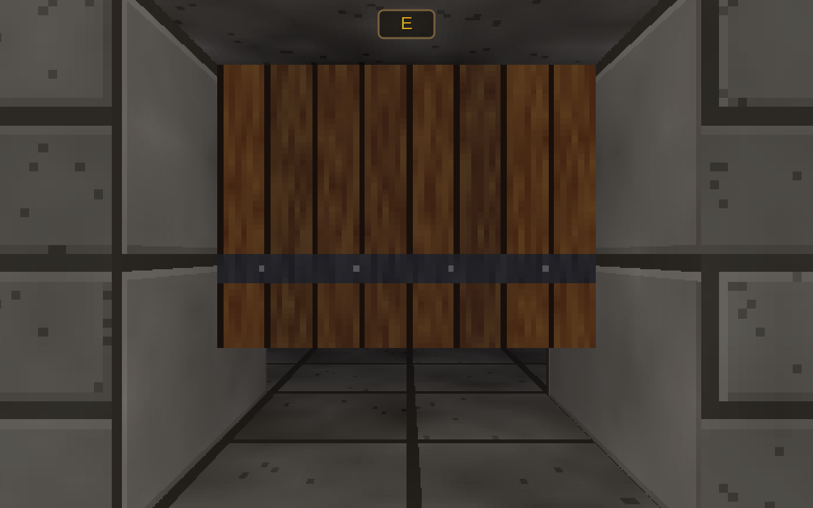
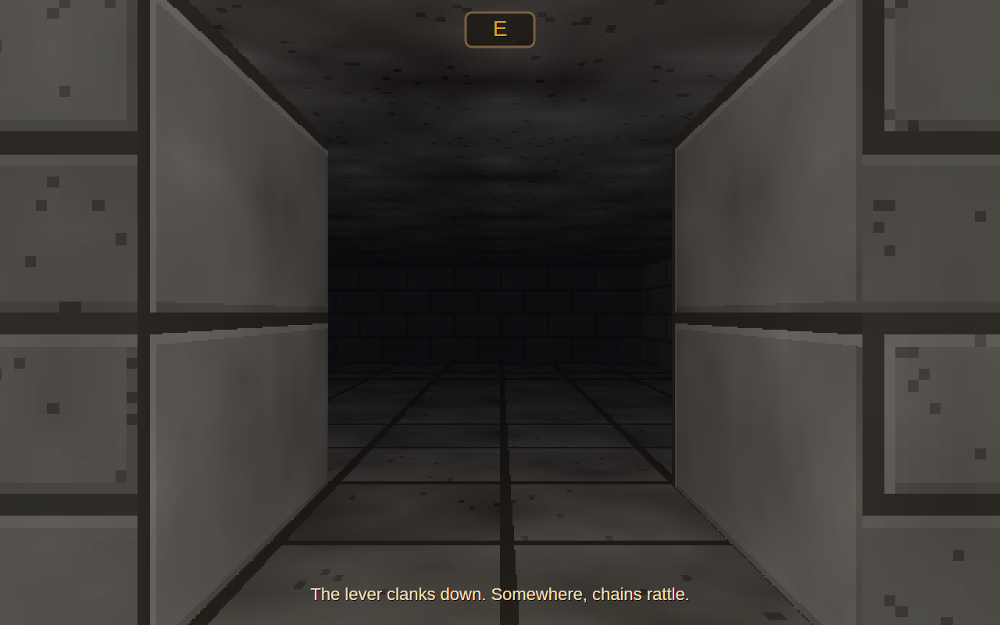

# AVAHack

A real-time, grid-based, first-person dungeon crawler in C# on .NET 10 and Avalonia 12. A party of delvers goes
down into the Hollow beneath Harrowgate, a dungeon that rearranges itself each time the town's bell tolls. It
mixes tabletop-style character building (six attributes, ancestries, callings, d20 rolls) with growth by use:
skills rise as you use them, and perk trees hang off each skill.

The design is in [`docs/SPECIFICATION.md`](docs/SPECIFICATION.md).

**Status: milestone M1.** The view, movement, doors and levers work in a 16×16 test level (M0). Under the
hood, the rules core is in (M1): attributes, d20 checks and saves, attacks and damage, the 14 conditions, the
skill XP and level curves, perks, and creating heroes from 8 ancestries, 10 callings and 8 backgrounds. None of
the rules is on screen yet. There are no monsters, party or items in the game yet.



| | |
| --- | --- |
|  |  |

## Playing (M0)

```bash
dotnet run --project src/AVAHack.App -c Release
```

| Action | Keys |
| --- | --- |
| Step forward / back | W / S, the Up / Down arrows, keypad 8 / 2 |
| Strafe left / right | A / D, keypad 4 / 6 |
| Turn left / right | Q / E, the Left / Right arrows, keypad 7 / 9 |
| Use what is ahead: open a door, pull a lever | F, Enter, keypad 5, or click it in the view |
| Frame rate and render time | F3 |

In the test level, the wooden doors open by hand. The portcullis does not. Its lever is on a wall nearby.

## How it is drawn

The view is drawn on the CPU by a column ray caster into a 640×400 framebuffer, which is then scaled up to the
window. Walls, floor and ceiling are textured and lit by the party's torch. Doors slide up into the ceiling, and
you can see through a portcullis. The textures are drawn in code. Because there is no GPU in the path, the
tests render real frames and compare them with golden images. A frame takes about 2.3 ms on an 8-core ARM
machine.

## Building and testing

```bash
dotnet build AVAHack.slnx
dotnet test AVAHack.slnx                       # no window opens
AVAHACK_SHOTS=/tmp/shots dotnet test AVAHack.slnx   # also save the views and window frames as PNGs
```

## Downloads

Every push to `main` builds self-contained, single-file programs for Windows, macOS and Linux (x64 and ARM).
They are attached to the [latest pre-release](../../releases/tag/latest). Tags `v*` make proper releases.

## Licence

MIT. See [LICENSE](LICENSE).
