# AVAHack

A real-time, grid-based, first-person dungeon crawler in C# on .NET 10 and Avalonia 12. A party of delvers goes
down into the Hollow beneath Harrowgate, a dungeon that rearranges itself each time the town's bell tolls. It
mixes tabletop-style character building (six attributes, ancestries, callings, d20 rolls) with growth by use:
skills rise as you use them, and perk trees hang off each skill.

The design is in [`docs/SPECIFICATION.md`](docs/SPECIFICATION.md).

**Status: milestone M8, plus a balance pass.** What's in so far:

- **The Delve.** A seeded, generated descent of up to 24 levels across six regions of four, each with its own
  creatures and boss, then the Unmade Heart, and below it the Knell, the bell whose tolls reshape the Hollow: break
  it to win. The newest regions:
  - **The Ossuary Stacks** (levels 13–16), a buried archive. Noise wakes its dead, candlelight gives you away, its
    shelves hold books, and the many-handed Archivist reads by his candles.
  - **The Rootdark** (levels 17–20), giant roots beneath the Works. Spore pods burst in clouds that fire sets
    alight, root tangles choke the passages, and burrowing worms come up behind you. The Mycel Crown can't be
    hurt while its nodes live, and the nodes grow back unless you burn them.
  - **The Glass Roads** (levels 21–24), halls of black glass where the Unmade broke through. Broken glass crunches
    and wakes the halls, rifts let the Unmade through until you seal them, glass creatures shatter under a hammer,
    and the Lens learns every blow you strike and throws a beam down the hall.
  Choose the seed, depth, monster strength, density, traps, magic items, food and Ironman before you start.
- **Your party.** Up to four heroes, made from ancestries, callings and backgrounds. Attributes come from a point
  buy, a 4d6 roll, or a heroic roll (10–18) that costs a quarter more XP for each level; each hero rolls once.
  Skills grow with use and kills bring experience, with level-ups and perk trees.
- **The bestiary.** 100 creatures in seventeen families, plus wanderers, each drawn in code. Elites and named champions
  carry the 16 affixes, and bosses guard each region's way down. On level 6 the optional Hollow Choir sings five
  schools: silence its voices in the order carved in their hall, or hush them.
- **Magic and loot.** 49 spells, and items with rarity, affixes, sets and uniques.
- **Crafting.** Alchemy with hidden reagent effects, cooking, Smithing and Enchanting.
- **Survival.** Food and water, and rests that can be interrupted.
- **28 handmade vaults,** at least two in every region, stitched into the generated levels.
- **Waystones** after each boss, with a merchant, a trainer, a shrine and a stash.
- **Saves.** Save slots, quick saves and Ironman.

The handmade first level, The Cellars, is still there to learn on. A full 12-level Delve is tuned to be winnable,
ending with heroes in their mid-twenties (spec section 31).

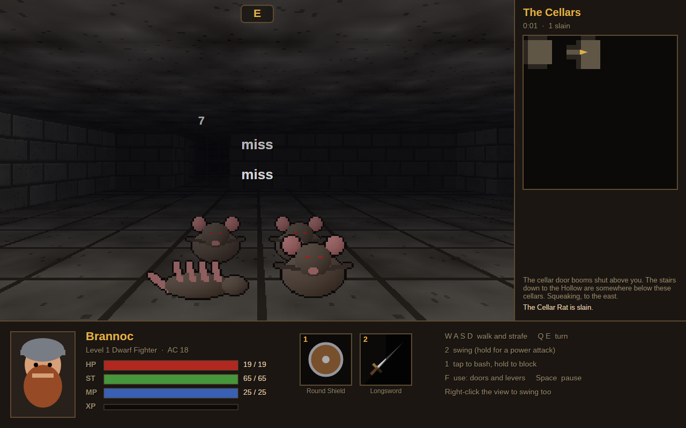

| | |
| --- | --- |
| 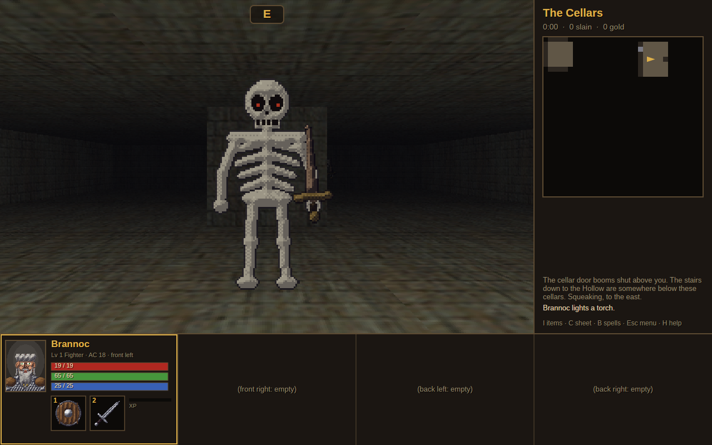 | 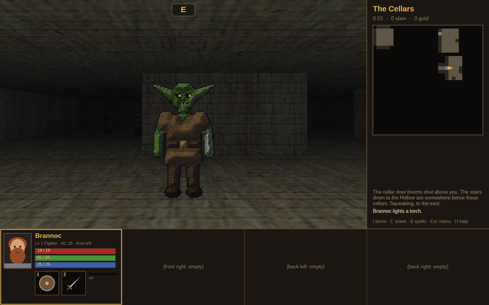 |
| 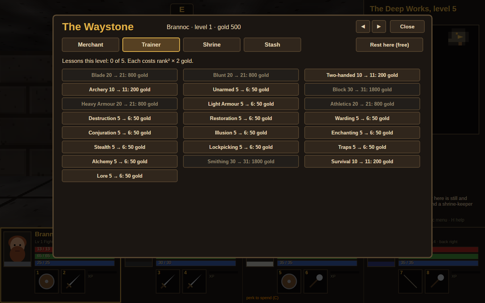 | 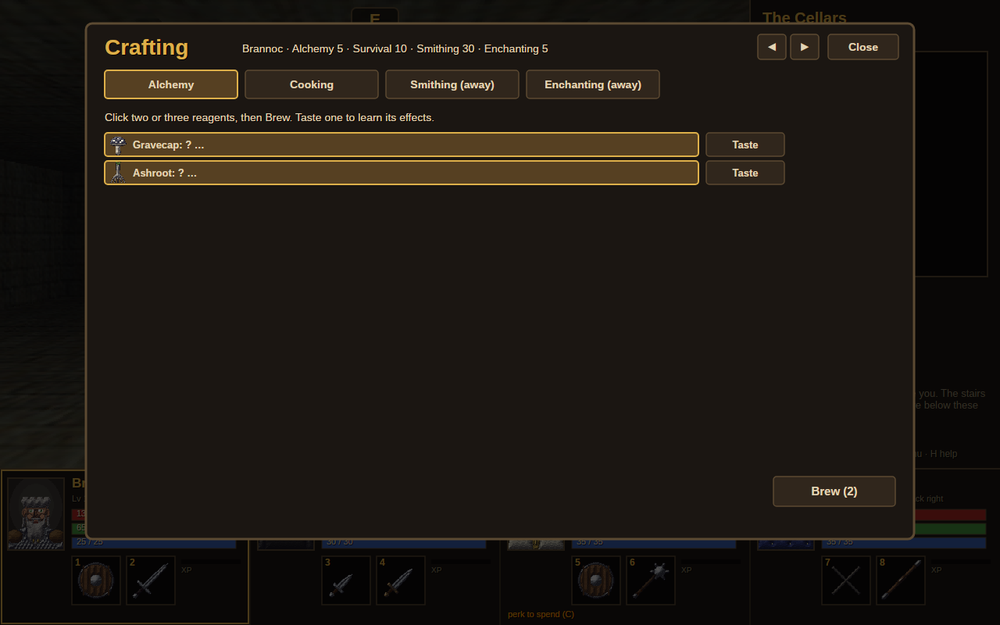 |

## Playing

```bash
dotnet run --project src/AVAHack.App -c Release
```

| Action | Keys |
| --- | --- |
| Step forward / back | W / S, the Up / Down arrows, keypad 8 / 2 |
| Strafe left / right | A / D, keypad 4 / 6 |
| Turn left / right | Q / E, the Left / Right arrows, keypad 7 / 9 |
| Each hero's left / right hand: swing (hold for a power attack), block, cast | 1 2 · 3 4 · 5 6 · 7 8, or click the hand |
| Use what is ahead: door, lever, chest, Waystone, forge, altar | F, Enter, keypad 5, or click it in the view |
| Pick up | G |
| Next hero / move the hero to a slot | Tab / Ctrl+1–4 |
| Inventory, character sheet, spellbook, crafting | I, C, B, K |
| Quick spells | F1–F8 |
| Sneak / rest | X / R |
| Pause | Space |
| Menu (save, load, quit, sound) / help | Esc / H |
| Quick save / quick load | F10 / F11 |
| Frame rate and render time | F12 |

Tips:
- **Every attack has a tell.** Watch for the wind-up and the glow. Step out of reach before the blow lands, or
  raise the shield just as it does: a perfect block costs nothing and staggers the attacker.
- **Hit them where they aren't looking.** A creature that isn't facing you is hit with advantage, and one that
  hasn't noticed you takes double damage.
- **Bone sentries stand up again** unless the killing blow is a crushing one. Bash the bones with the shield.
- **Out of a fight you heal slowly.** Rest with R, but behind a shut door if you can: things wander.
- **A boss seals the stairs down.** The Bellwright Engine can't be hurt until its three valves are shut, and Mother of
  Coils only when the water drops.
- **Taste reagents to learn them,** then brew two or three that share an effect. A brew of pure poison coats your
  blade.

## How it is drawn

The view is drawn on the CPU by a column ray caster into a 640×400 framebuffer, which is then scaled up to the
window. Walls, floor and ceiling are textured and lit by the party's torch. Doors slide up into the ceiling, and
you can see through a portcullis. Creatures are camera-facing pictures with front, side and back views, drawn
against a depth buffer.

Each region's walls, floors and ceilings come from Screaming Brain Studios' CC0 *Old School Dungeon Crawler Pack*,
converted by `tools/import-sbs-textures.sh`. The doors, levers, pits, plates, stairs and markings are drawn in
code.

The creatures are drawn in code too, all 62, on a 64-unit grid at 128 pixels. A finishing pass shades them as
pixel art:
- each patch of colour is lit as a rounded surface from the upper left, with a five-step ramp of cool shadows and
  warm highlights;
- tones are ordered-dithered between steps;
- overlapping parts cast contact shadows;
- fur, metal, bone, slime, stone and cloth get their own grain or shine;
- outlines take a deep shade of the colour they border.

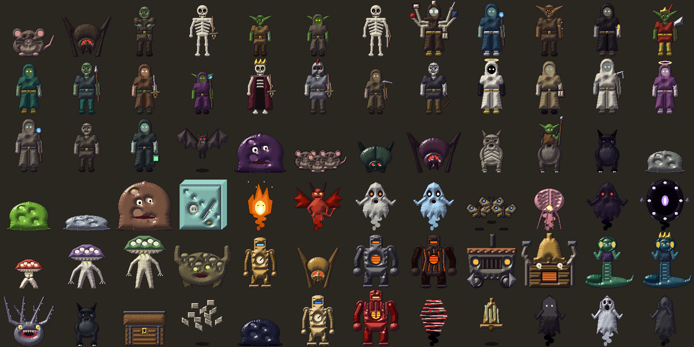

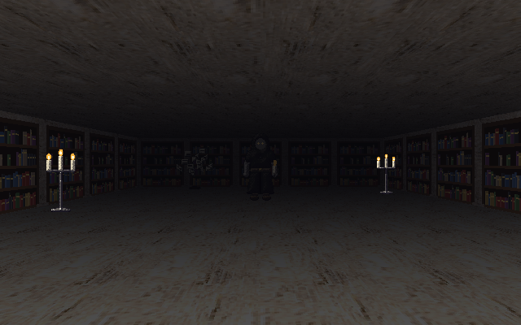

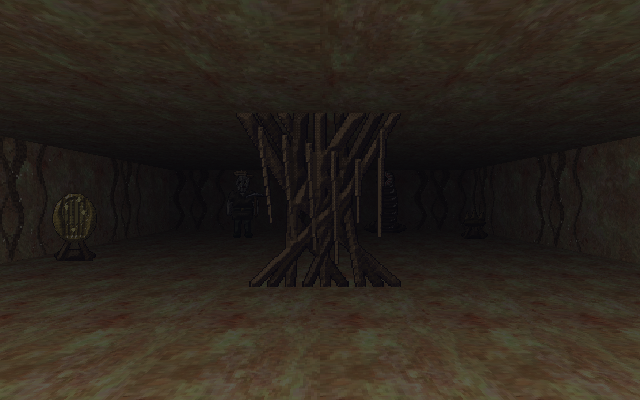

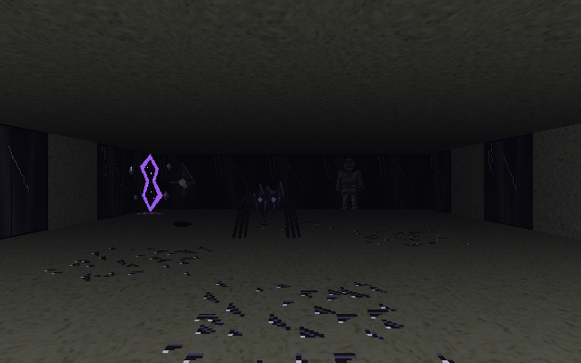

Every item has its own icon, drawn and finished the same way:
- 18 weapons, 8 armours, 3 shields and 12 pieces of gear;
- potions, scrolls, books by skill, tomes and wands;
- 40 reagents, the ingredients and meals, home-made brews coloured by their effect, and the crafting tools.

The icons show in the inventory, the hand slots, the Waystone's lists and the crafting screen.

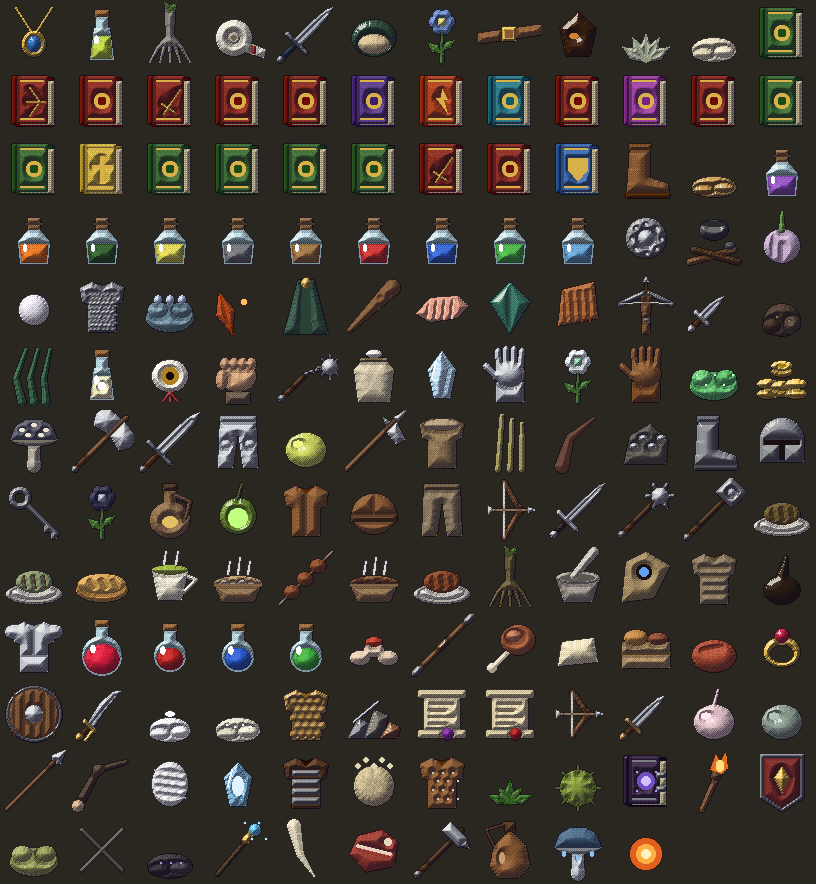

The heroes' portraits are drawn the same way:
- the ancestry sets the face: skin, ears, a dwarf's braided beard, an orc's tusks, a saurian's scaled snout and
  crest, an emberkin's horns and ember eyes;
- the calling sets the clothes and headgear, from a wizard's hat to a druid's antlers or a rogue's scarf;
- the hero's name picks the hair, its colour, a beard and the eyes, so a hero always looks the same;
- a downed hero turns grey with closed eyes.

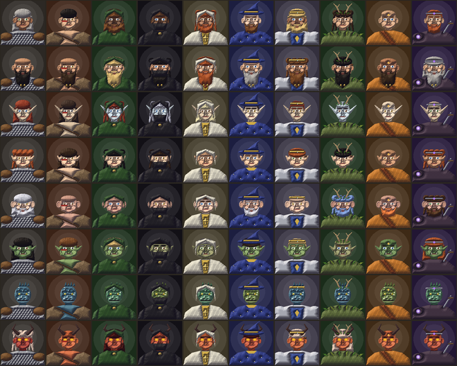 Every third-party file is listed in `assets.manifest.json`, and [`CREDITS.md`](CREDITS.md) is
made from it by `tools/build_credits.py`. Because there is no GPU in the path, the
tests render real frames and compare them with golden images. A frame takes about 1–3 ms on an 8-core ARM
machine.

## How it sounds

Every sound is made by `tools/make_sounds.py`, a standard-library Python script that synthesises them from
oscillators, noise and filters with fixed seeds. There are 86 effects (96 takes, since the common ones have several),
and an ambience loop for each region:
- dripping cellars;
- the Works' machinery;
- the Drowned Choir's hum;
- the Unmade Heart's drone and heartbeat;
- the Ossuary Stacks' rustling pages and guttering candles, the Rootdark's creaking roots, and the Glass Roads'
  wind and settling glass.

Sound is positional and travels along the passages:
- it fades with the steps it has to go, and a shut door muffles it;
- solid rock stops it, and nothing carries past 16 steps;
- it is panned to the side it comes from.

You hear a creature's footsteps and its cry before you see it, and spikes and blades cycling round the next corner.
Bosses have a sting when they wake and a chord when they fall.

Playback is OpenAL Soft. In a virtual machine the game picks a bigger mixing buffer so the sound doesn't break up.
The Menu (Esc) sets the volume, the ambience and the buffer size.

## Building and testing

```bash
dotnet build AVAHack.slnx
dotnet test AVAHack.slnx                       # no window opens
AVAHACK_SHOTS=/tmp/shots dotnet test AVAHack.slnx   # also save the views and window frames as PNGs
dotnet test tests/AVAHack.Core.Tests --filter "BalanceReport|DelveReport" --logger "console;verbosity=detailed"   # the bot's runs
```

## Downloads

Every push to `main` builds self-contained, single-file programs for Windows, macOS and Linux (x64 and ARM).
They are attached to the [latest pre-release](../../releases/tag/latest). Tags `v*` make proper releases.

## Licence

MIT. See [LICENSE](LICENSE).
